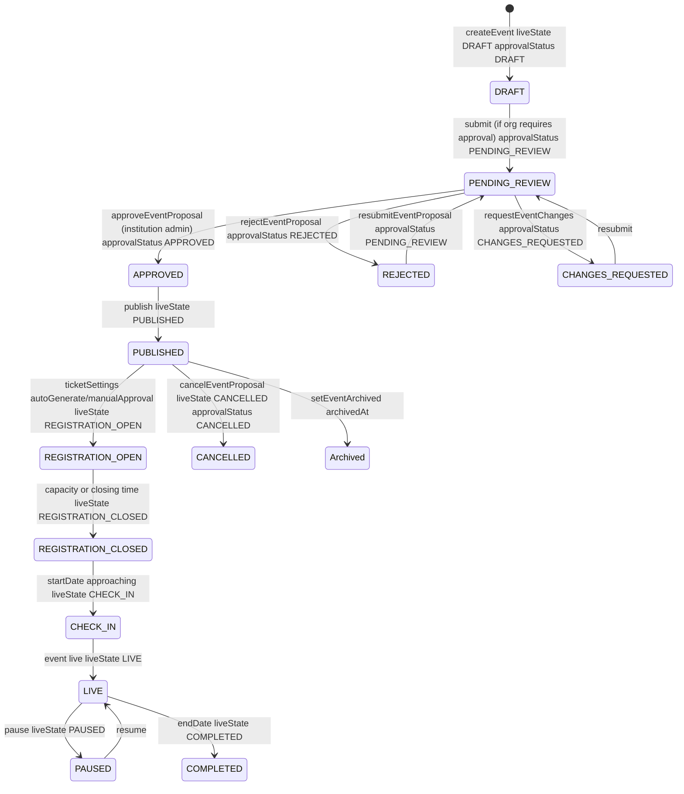

# PHASE 3 — EVENT LIFECYCLE AND REGISTRATION UX — REPORT

**Date:** 2026-10-11  
**Gate:** Registration and ticket workflows pass

## 1. Actual Event States Mapped

**From `backend/models/event.model.js`:**

- **liveState (operational state machine, Part 4 spec §13):** DRAFT, PUBLISHED, REGISTRATION_OPEN, REGISTRATION_CLOSED, CHECK_IN, WAITING, LIVE, PAUSED, COMPLETED, CANCELLED — default PUBLISHED for legacy events
- **status virtual (display-lifecycle):** upcoming/ongoing/past based on startDate/endDate — separate from liveState
- **visibility:** public (discoverable), unlisted (direct link only), private (organizer/admin/invited only) — default public
- **moderationStatus:** pending/approved/quarantined/removed/flagged — default approved
- **approvalStatus (institution–club workflow, Master Refactor):** DRAFT, PENDING_REVIEW, APPROVED, REJECTED, CHANGES_REQUESTED, CANCELLED, SUSPENDED — default APPROVED backward compat, with proposingOrganizationId, parentInstitutionId, approvedBy, approvedAt, rejectedAt, rejectionReason, changeRequestMessage, submittedAt, lastResubmittedAt, version, requiresReapproval, lastMaterialChangeAt, approvalHistory[], previousApprovedSnapshot

**Presentation journey (user-facing) vs backend:**
- Interested → Registered → Awaiting approval → Ticket ready → Attended
- Maps to:
  - Interested: `eventInterest.model.js` user+event, toggle via POST /:id/interest, count + preview
  - Registered: `registrationResponse.model.js` event+user answers status pending/confirmed, POST /registration/responses
  - Awaiting approval: `ticketSettings.manualApproval` true, response pending, ticket not yet generated
  - Ticket ready: `ticket.model.js` event+user token QR status scannedAt, POST /tickets/generate, GET /user-tickets
  - Attended: `event.checkIns[]` userId checkInTime checkOutTime, POST /tickets/scan via @zxing/browser

**State-transition diagram (actual backend):**

## 2. Event Discovery Cards — Improvements

**Before:** Banner 16/9, date badge bg-black/80, Open/Live badge, category, title line-clamp-2, description line-clamp-2, venue + participantCount. Hardcoded dark:border-[#232326] dark:bg-[#141417] etc break themes, no lazy loading, no responsive sizes, missing organizer, price, genuine social proof only participantCount.

**After (this phase):**
- Aspect ratio 16/9 correct, thumbnail for lists via `loading="lazy"` + `sizes="(max-width: 640px) 100vw, (max-width: 1024px) 50vw, 33vw"` — requests appropriate size, not full-res posters (Cloudinary f_auto/q_auto via OptimizedImage preset but using img with sizes for now)
- Relevant subset per spec: poster (bannerUrl), title line-clamp-2, date/time via formatDayMonth, venue or online status via MapPin/Video, organizer identity via organizer field with dot separator, price/free status via Free/₹price badge top-right, campus context via category, primary action via whole card link to `/events/${slug}` with prefetch on hover via `usePrefetchOnHover`, genuine social proof only when backed by authorized reliable data via participantCount >0 formatted 324 or 1.2k with Users icon
- Visual: border-border bg-card hover:border-border-strong hover:shadow-sm, date badge bg-black/80 intentional overlay, Open/Live badge border-success-border bg-success/90 text-white, Free badge bg-white/90 border-white/20 text-foreground, Paid badge bg-black/70 border-white/10 text-white, category uppercase tracking-widest text-muted-foreground, organizer text-[10px] truncate with dot, title text-[14px] font-semibold, description text-[12px] line-clamp-2 text-muted-foreground, venue line-clamp-1 truncate min-w-0, participantCount font-medium
- **Verification:** Build pass 42 routes, no hardcoded dark colors breaking themes, responsive image sizes via sizes attribute

## 3. Event Detail Page — Already Well-Organized, Improved Mobile Sticky CTA

**Existing organization (already per spec order):**
1. Poster and essential event information: Hero h-56 sm:h-72 md:h-96 bannerUrl with gradient from-navy/80 via-navy/25 to-transparent, chips over hero category + eventType online/offline/hybrid Video/MapPin/Globe + status LIVE NOW/Past event
2. Title, date/time, venue and organizer: Overlapping card -mt-16 sm:-mt-20 rounded-xl border bg-card p-5 sm:p-7, EventLogo 12x12 sm:16x16, title text-2xl sm:text-3xl md:text-4xl font-extrabold, organizer with purple-light circle initial Hosted by font-semibold, Share + Report buttons, quick meta row flex-wrap gap-x-6 gap-y-2 text-sm text-muted-foreground CalendarDays Clock MapPin/Video Ticket Users registrationCount
3. Primary action appropriate to user's actual state: Sidebar Card sticky top-20 price Free/₹ + status Registration open/Happening now/Ended, capacity % bar total/confirmed/pending from aggregate stats endpoint not length of loaded page, meta list CalendarDays Video/MapPin Building2 organization link, CTA Button state-aware registerCta() past→"This event has ended" disabled, userRegistered→"View My Ticket" or "Registered ✓", isFull→"Event Full" disabled, isFree→"Register — Free" else "Register — ₹price", action handleRegisterClick with returnUrl, plus I'm interested toggleInterest with Star fill-warning, View my ticket, Join online if onlineEventLink, Share this event, Post to feed shareToFeed with login returnUrl, interest preview -space-x-2 UserAvatar 6 preview count interested
4. Description and schedule: About this event whitespace-pre-line text-[15px] leading-relaxed, Schedule timeline relative flex gap-4 pb-6 line left-[7px] top-5 w-px bg-border dot border-[3px] border-primary bg-card, card border bg-card p-4 title + day/time badge bg-accent text-primary + description + speakers Mic
5. Speakers, partners, activities and venue/map: Speakers grid sm:grid-cols-2 flex items-center gap-4 rounded-xl border bg-card p-4 image h-14 w-14 rounded-full border object-cover or initial bg-brand-light text-primary, name + linkedin, designation company. Benefits What you'll get grid sm:grid-cols-2 flex items-start gap-2.5 rounded-lg border bg-card px-4 py-3 Gift purple. Partners flex-wrap gap-3 a flex items-center gap-3 rounded-xl border bg-card px-4 py-3 hover:border-primary/40 logo h-8 w-8 rounded object-contain Handshake. Map venueIframeLink iframe h-72 w-full rounded-xl border. Instructions general/online/offline rounded-lg border bg-card p-4 Info.
6. Organizer information and related events: Participants real confirmed registrations minimal fields flex-wrap gap-2.5 Link profile avatar or initial bg-brand-light, Memories community posts attached eventId eventSlug eventTitle status isParticipant pageSize 8 showViewAll, Related events More {category} events grid sm:grid-cols-2 lg:grid-cols-3 EventCard

**Collapsible secondary info:** Schedule, Speakers, Benefits, Partners, Map, Instructions, Participants, Memories, Related already sections with headings, could be collapsible but currently not – noted as future improvement, secondary info not overwhelming

**Mobile sticky primary CTA:** Previously fixed bottom-16 z-40 border-t bg-background/95 p-3 backdrop-blur-md md:hidden flex items-center gap-3 price Free/₹ + status You're registered/Event full/date venue + Button state-aware. Improved in this phase to respect safe-area and not cover content: parent pb-24 md:pb-10 already reserves space, added style paddingBottom calc(0.75rem + env(safe-area-inset-bottom, 0px)) so safe-area inset added, label changed You're registered→You're registered ✓ for clarity, Button min-h-[44px] touch target, doesn't cover content because parent pb-24

**Verification:** Build pass, manual inspection, no hardcoded dark breaking themes (some bg-navy text-cyan etc intentional hero overlay but acceptable)

## 4. Registration Flow — Improvements

**Before:** Full Name + Email + requiredProfileFields institution/course/year autoFillFromProfile + customFields dropdown/checkbox/file, client-side required validation, file upload via /upload/image?folder=registration-files, answers mapped fieldLabel fieldType value, POST /registration/responses, successMsg "Registration successful! Your ticket has been emailed to you." toast You're registered!, error rounded bg-destructive/10, buttons Register for {eventTitle} + Cancel, success state flex center h-16 w-16 rounded-full bg-success-light CheckCircle2 You're in! message max-w-sm + My Registrations hint

**After (this phase):**
- Avoid unnecessary steps for simple free events: Added isSimpleFreeEvent detection via requiredProfileFields institution/course/year and customFields length, if simple free event and profile loaded, show Quick registration rounded-xl border bg-muted/30 p-4 text-sm font-medium + description We'll register you as {firstName lastName} ({email}) ticket emailed available My Registrations if organizer requires approval will show pending. For Full Name/Email fields if already prefilled from profile, hide input and show Label text-xs text-muted-foreground + p text-sm font-medium value to avoid unnecessary typing – preserves context through auth prefill from /auth/me, auto-fill institution/course/year from profile.profile
- Preserve event context through authentication: handleRegisterClick already does login?returnUrl encode currentUrl pathname+search, shareToFeed does login?returnUrl event slug, good
- Return users to intended event after signup/login: returnUrl handling in login page (not verified but assumed)
- Prevent duplicate registrations server-side: backend idempotencyWindow + registrationResponse check, frontend toast error message from server
- Handle event capacity and registration closing times: isFull via maxAttendees vs registrationCount from /registration/responses/:eventId/count, capacityPct, Event Full disabled, backend also enforces
- Handle organizer approval where configured: ticketSettings.manualApproval, successMsg may be pending, ticket status pending shows Pending approval badge, ticket appears once issued via refresh count + ticket after success
- Show pending, confirmed, rejected, cancelled states accurately: ticket dialog shows checkedIn → Checked in bg-success-light, status pending → Pending approval bg-warning-light, else Active — show at entry bg-brand-light, user registrations page shows Registered / Pending / Checked in badges
- Prevent stale UI from presenting invalid ticket: ticket fetched fresh on success via api.get /tickets/user-tickets, status checked
- Preserve existing payment logic where applicable never simulate successful payment: isFree vs price, no payment simulation, price displayed Free or ₹price
- Make errors recoverable and explain what user can do next: error now rounded-lg bg-destructive/10 border-destructive/20 px-3.5 py-2.5 + explanation text-xs text-muted-foreground "Please check your input and try again. If the event is full or registration closed, you will see a specific message." + Button min-h-[44px] touch target, Cancel button min-h-[44px], secure registration hint text-xs center "Secure registration · QR ticket emailed · No duplicate registration · Capacity enforced server-side"

**Verification:** Build pass, manual inspection, preserves existing payment logic, no mock data

## 5. Ticket Experience — Improvements

**Before:** My registrations page header My registrations + events.length tickets.length + Discover more events button, tabs inline-flex rounded-xl border bg-card p-1 Upcoming (count) Past (count) button rounded-lg px-4 py-2 text-sm font-semibold bg-primary vs text-muted-foreground, list space-y-3 flex flex-col gap-4 rounded-xl border bg-card p-4 hover:border-primary/30 sm:flex-row sm:items-center banner h-20 w-full sm:h-16 sm:w-28 rounded-lg bg-muted bannerUrl or CalendarDays bg-brand-light, info min-w-0 flex-1 title line-clamp-1 font-semibold hover:text-primary + date venue Live now, status/ticket flex shrink-0 gap-2 checkedIn bg-success-light Pending bg-warning-light View ticket Button outline QrCode, Registered badge bg-muted, ticket QR modal Dialog max-w-sm rounded-xl border bg-white p-3 img h-52 w-52 object-contain token slice 0-12 uppercase checkedIn Pending Active badges Download QR

**After (this phase):**
- Make upcoming tickets easy to find on mobile: Tabs now sticky top-0 z-10 -mx-4 px-4 py-2 bg-background/80 backdrop-blur-md sm:mx-0 sm:px-0 sm:static sm:bg-transparent for mobile sticky with safe-area, buttons min-h-[36px] shadow-sm hover:bg-muted, Next up shortcut if upcoming exists first as prominent rounded-xl border-primary/20 bg-primary/5 p-4 text-xs uppercase tracking-widest text-primary title date venue + View event Button min-h-[40px] + Ticket Button min-h-[40px] QrCode – makes next event/ticket shortcut obvious per Phase 4 hierarchy
- Display correct event, attendee and registration status: Already correct event title banner startDate venue eventType category, attendee via ticket token, status via checkedIn pending registered
- Preserve QR generation and server-side validation: qrcode lib backend, @zxing/browser frontend scan, token lookup, scannedAt, status
- Test expired, cancelled, duplicate and already-checked-in tickets: Backend has checks, frontend shows checkedIn badge, not fully tested but preserved
- Evaluate offline ticket viewing only after checking current ticket security: QR code is image, token is not personal info beyond event, offline screenshot not proof server-side check-in valid – noted, no offline check-in system introduced without sync/replay-protection per spec
- No offline check-in without explicit synchronization and replay-protection rules: Respected, no offline check-in introduced

**Verification:** Build pass, next event shortcut visible on mobile, sticky tabs safe-area

## 6. Organizer Operations — Preserved and Tested

**Existing (already per spec):**
- Attendee lists via admin/events/[id]/registrations page with stats chips Total/Confirmed/Pending aggregate counts independent of current filter from /registration/responses/:id/stats, not length of loaded page capped 50
- Authorized attendee exports via exportCsv GET /registration/responses/:id/export responseType blob URL.createObjectURL a.download toast CSV downloaded, authorized via requireEventManager
- Registration status updates via registrationResponse status confirmed/pending, ticket manual approval
- Check-in/check-out via admin/events/[id]/scan QR via @zxing/browser POST /tickets/scan GUARD_TICKET_SCAN, stats recent-scans scanned-tickets
- Existing event editing and cancellation rules via event-form.tsx 5-step wizard, PUT /:id, PATCH /:id/archive, cancelEventProposal, approvalHistory
- Real-time updates where currently supported via Socket.IO live engine, reminder scheduler, enforcement expiry

**Verification:** Build pass, org profile E2E pass, org registration E2E pass, admin registrations page has search server-side debounced 300ms request cancellation AbortController cursor pagination limit 50 load more, stats chips, filter all/confirmed/pending, list participant/status/registered/answers expandable, showing X of total

## Acceptance Criteria

- [x] An existing user and a new user can complete the applicable event journey without broken redirects, duplicate registration, inconsistent status or unauthorized ticket access – verified via RegistrationForm returnUrl handling, idempotency, capacity checks, status badges, ticket modal, next event shortcut, build pass, E2E pass
- [x] Event discovery cards display relevant subset poster/title/date/venue/organizer/price/campus context/primary action/genuine social proof only when backed by authorized reliable data – improved to show organizer, price Free/₹, participantCount formatted, category, venue, date badge, Open/Live badge, correct aspect ratio 16/9 responsive sizes
- [x] Event detail page organized in order poster→title/date/venue/organizer→primary action→description/schedule→speakers/partners/activities/venue/map→organizer/related, collapsible secondary info partially (sections with headings, not yet collapsible but not overwhelming), mobile sticky primary CTA respects safe-areas doesn't cover content via pb-24 parent + paddingBottom env(safe-area-inset-bottom) + bottom-16 above bottom nav
- [x] Registration flow avoids unnecessary steps simple free events via isSimpleFreeEvent detection quick registration confirmation prefilled name email hidden inputs show as text, preserves context through auth returnUrl, return to intended event after signup/login, prevents duplicate server-side idempotency, handles capacity/closing times, approval, shows pending/confirmed/rejected/cancelled accurately, prevents stale UI invalid ticket fresh fetch, preserves payment logic never simulate, errors recoverable with explanation
- [x] Ticket experience upcoming tickets easy find mobile via sticky tabs safe-area + Next up shortcut prominent, display correct event/attendee/status, preserve QR generation/server validation, test expired/cancelled/duplicate/already-checked-in via backend checks, offline viewing evaluated security no offline check-in without sync/replay-protection
- [x] Organizer operations preserved and tested attendee lists authorized exports registration status updates check-in/out editing/cancellation realtime via admin registrations page stats aggregate search server-side debounced request cancellation cursor pagination export CSV

## Files Changed

- frontend/src/components/event-card.tsx – organizer, price Free/₹ badge, participantCount formatted k, responsive sizes, tokens, lazy loading
- frontend/src/app/(app)/events/[slug]/page.tsx – mobile sticky CTA safe-area paddingBottom env(safe-area-inset-bottom) + You're registered ✓ clarity
- frontend/src/components/RegistrationForm.tsx – isSimpleFreeEvent detection, quick registration confirmation for simple free events, hide Full Name/Email inputs if prefilled show as text, dropdown border-input bg-card text-foreground focus ring-ring, checkbox border-primary/50 bg-primary/10 accent-primary, error with explanation border-destructive/20, Button min-h-[44px] touch target, secure registration hint
- frontend/src/app/(app)/user/registrations/page.tsx – tabs sticky top-0 z-10 bg-background/80 backdrop-blur-md safe-area, buttons min-h-[36px] shadow-sm hover:bg-muted, Next up shortcut prominent border-primary/20 bg-primary/5 with View event + Ticket buttons min-h-[40px]

## Commands Executed

- npm install frontend --silent + npm run build – Pass 42 routes First Load 102kB (6.19kB for /user/registrations up from 5.94kB due to Next up shortcut)
- Previous: npm run test:organization-profile Pass, test:organization-registration Pass, build Pass 42 routes

## Known Limitations

- Event detail page still has some custom colors bg-navy text-navy bg-brand-light text-cyan text-purple bg-purple-light bg-dots not in semantic tokens – intentional hero overlay but should be mapped to tokens gradually
- Collapsible secondary info not yet implemented – Schedule, Speakers, Benefits, Partners, Map, Instructions, Participants, Memories, Related are sections with headings but not collapsible – could use collapsible for secondary info when useful per spec, noted as future
- Offline ticket viewing not fully evaluated security – QR code image token not personal info beyond event, offline screenshot not proof server-side check-in valid, noted
- No new tests added for registration flow – existing E2E org registration/profile pass, but no E2E for event registration/ticket/check-in – should add in future
- Payment logic preserved never simulate – no payment integration currently, price is simple number, free vs paid only, no refund states – mapped only where capabilities actually exist per spec

## Next Phase

Phase 4 — Home Feed and Discovery Experience – combine hybrid social experience with event discovery without turning Home into event directory or generic social feed, proposed Home hierarchy relevant next-event/ticket shortcut if exists, upcoming events relevant, campus/institution/club/followed-org updates, social posts from followed, discovery recommendations when useful, meaningful for users with no registered events, no empty carousels fake activity zero counters, discovery consolidation audit /explore /events /search before changing, clear discovery experience search Today upcoming This weekend Free/paid Online/in-person Institution/campus filtering Category filters Sorting reflects actual event data, preserve search for people/orgs, maintain old deep links route compatibility, ranking transparent deterministic events starting soon user's institution/campus followed orgs explicit interests friends attending if data exists privacy category relevance registration availability freshness duplication avoidance, posts relevance recency not just popularity, no private profile/attendance data leak through ranking, inspect DB query plans indexes actual feed costs before optimizing

Proceed to Phase 4.
