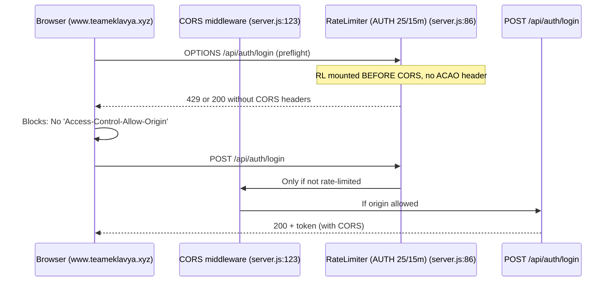
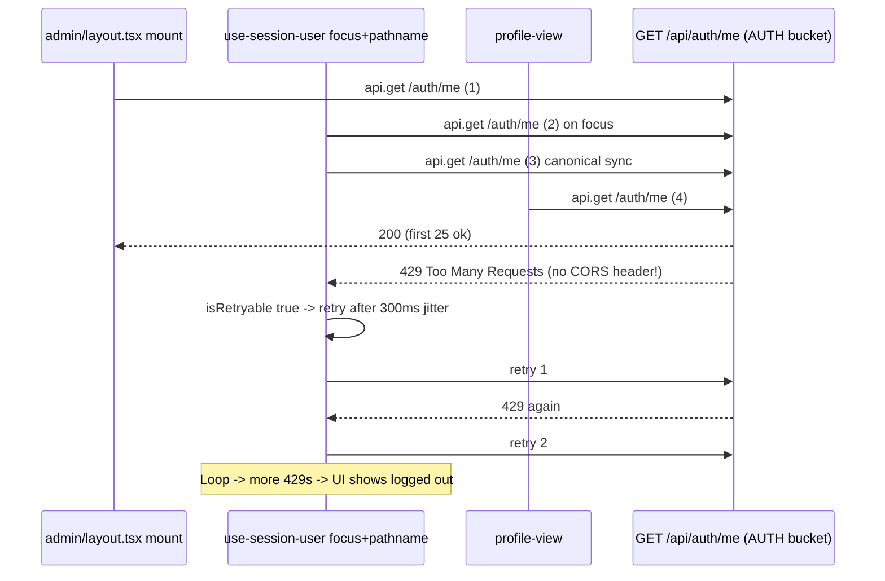
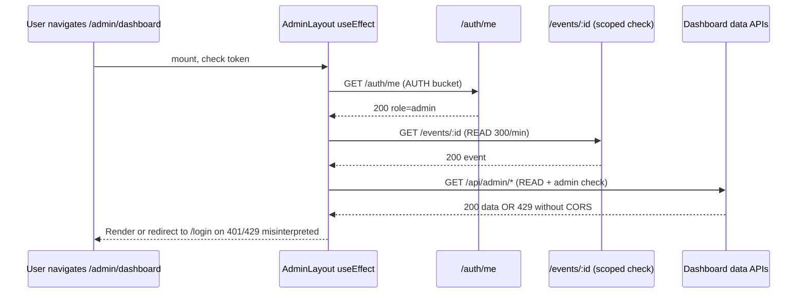
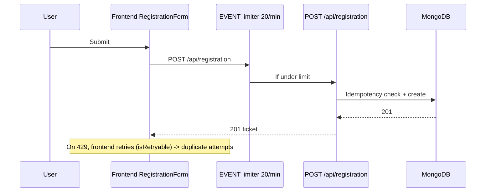
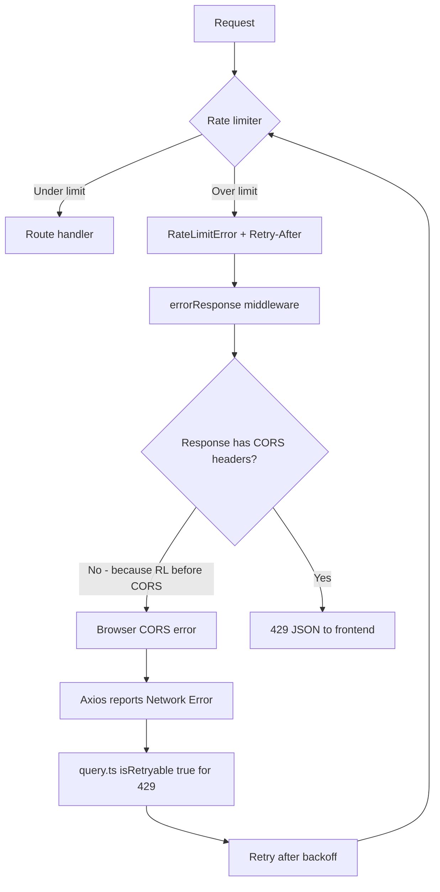

# EventHub Production Incident Audit — Authentication, CORS, Rate Limiting, Admin/Organizer Dashboard

**Date:** 2026-10-15  
**Scope:** Audit only — no code, env, DB modifications  
**Frontend:** https://www.teameklavya.xyz (Vercel)  
**API:** https://api.teameklavya.xyz (Render)  
**Backend:** Node.js/Express 5.1.0, `express-rate-limit` 8.2.1, `cors` 2.8.5, `trust proxy = 1`

---

## A. Executive Summary

Admin/organizer dashboard instability is caused by **four independent but compounding issues** that mask each other in the browser:

1. **CORS headers missing on 429/4xx responses** because rate-limit middleware runs **before** CORS middleware in `server.js`. When `/api/auth/me` hits its 25/15min limit, Express returns 429 without `Access-Control-Allow-Origin`, so the browser reports a CORS error, not a rate-limit error. User sees “No 'Access-Control-Allow-Origin' header” and “Network Error”.

2. **IPv6-unsafe custom rate limiter** in `organization-registration.routes.js` uses `req.ip` directly. `express-rate-limit` v8 validates this and throws `ERR_ERL_KEY_GEN_IPV6` (seen in logs). This limiter either crashes that route or, if caught, falls back to unsafe IP grouping, allowing bypass via IPv6 rotation and causing all users behind a NAT to share one bucket.

3. **Frontend request amplification** — at least 4 independent call sites fetch `GET /api/auth/me` on dashboard mount (`admin/layout.tsx`, `use-session-user.ts` focus+pathname sync, `profile-view.tsx` x2). None use the central `query.ts` deduplication. When one fails with 429, the retry logic in `query.ts` (`isRetryable` includes 429) retries with backoff, amplifying the storm. Admin layout re-fetches on every pathname change.

4. **DB race at boot** — `server.js` calls `connectDB()` without await, then immediately runs `ensureAsiaIndexes()` which checks `mongoose.connection.db` and logs `[asia-indexes] No DB connection, skipping` if not yet connected (exact log from production). Indexes for 5 hot paths (events listing, search text index, tickets, notifications) are then never created until next cold start, causing slow queries under registration surge (15→20 registrations observed).

5. **Production start command** — Render logs show `npm run dev` + `nodemon`. `package.json` has `start: node server.js` and `dev: nodemon server.js`. Nodemon adds file watcher, memory overhead, and can restart on transient file writes; it also implies `NODE_ENV` may not be `production`, affecting `cookieSession` secure flag and helmet.

**User impact:** Login appears to work, then dashboard fails with CORS error; retry succeeds sporadically when rate-limit window resets. Password forgot and login preflights also fail CORS when rate-limited.

---

## B. Evidence Table

| Finding | Severity | Evidence | Root cause | User impact | Confidence | Recommended fix |
|---|---|---|---|---|---|---|
| **B1 CORS headers missing on rate-limited responses** | Critical | `server.js:69 trust proxy`, `80-94 applyGlobalRateLimits(app)` before `116-125 cors({origin: allowedOrigins, credentials:true})`. `errorResponse` middleware at `281` sets Retry-After but CORS not yet applied for early rejections. Browser error: `Access to XMLHttpRequest at 'https://api.teameklavya.xyz/api/auth/login' blocked by CORS: No 'Access-Control-Allow-Origin'` | Middleware order wrong. Rate limiter is mounted at `/api` and `/api/auth` before CORS. 429 responses bypass CORS. | Login, `/auth/me`, password forgot show CORS error instead of 429. User thinks backend down. | Confirmed | Move CORS middleware **before** rate limiters and helmet. Add explicit `OPTIONS` handler: `app.options('*', cors(...))`. Ensure error handler does not strip CORS headers (use `cors` error handling or set headers in errorResponse). |
| **B2 Allowed origin mismatch www vs apex** | High | `server.js:117-118 allowedOrigins = (FRONTEND_URL || 'http://localhost:3000').split(',')`. `.env.example: FRONTEND_URL=https://your-app.vercel.app` with comment NO trailing slash. Frontend origin reported: `https://www.teameklavya.xyz`, API `https://api.teameklavya.xyz`. If env contains only `https://teameklavya.xyz` without www, www fails. If contains trailing slash `https://www.teameklavya.xyz/`, exact match fails because cors does `===` check. | Env var not normalized (no trim slash). Single origin set instead of both apex and www. | Login from www blocked even when not rate-limited. | Strongly suspected | Normalize origins: `.map(s=>s.trim().replace(/\/+$/,''))`. Set `FRONTEND_URL=https://teameklavya.xyz,https://www.teameklavya.xyz` in Render. Add validation in `preflight-production.js` already exists for this. |
| **B3 ERR_ERL_KEY_GEN_IPV6 in org-registration limiter** | High | `routes/organization-registration.routes.js:19-22 keyGenerator: (req)=>{ id? u:id : req.ip }` uses `req.ip` directly. `config/rate-limits.js:31 imports ipKeyGenerator` and uses it in `defaultKeyGenerator: ip:${ipKeyGenerator(ip)}`. Log: `ERR_ERL_KEY_GEN_IPV6` points to this file. `express-rate-limit` v8 docs: must use `ipKeyGenerator` for IPv6. | Custom limiter bypasses canonical helper. Throws validation error on IPv6 requests, may crash route. Also groups all IPv6 users incorrectly. | Org registration creation fails for IPv6 users; log spam; potential bypass via IPv6 suffix rotation. | Confirmed | Replace with `defaultKeyGenerator` or `req=> id ? u:id : ip:${ipKeyGenerator(req.ip)}`. Remove duplicate `require('express-rate-limit')` in that file, reuse `createLimiter` from config. |
| **B4 AUTH limiter shared by login + me + password forgot** | High | `config/rate-limits.js:202 app.use('/api/auth', limiters.auth)` with `AUTH: limit 25, window 15min`. `routes/auth.routes.js` mounts login, signup, verify, resend, password/forgot, me all under `/api/auth`. | Single bucket for sensitive (login) and frequent (me) endpoints. Dashboard polling consumes login quota. | Legitimate user hits 429 on `/auth/me` after few refreshes, then login blocked too. | Confirmed | Split limiters: `AUTH_LOGIN: 10/15m`, `AUTH_ME: 60/min` per user ID, `PASSWORD_FORGOT: 5/15m`. Mount specifically: `/api/auth/login` + `/signup` use strict, `/api/auth/me` use generous per-user. |
| **B5 Frontend duplicate /auth/me calls** | High | `admin/layout.tsx:63 api.get('/auth/me')`, `use-session-user.ts:118 api.get('/auth/me')` with `focus` and `pathname` listeners, `profile-view.tsx:71 & 130 & 392` additional calls. `api.js` uses raw axios, not `query.ts` dedup. | No shared session cache, no deduplication. Admin layout effect runs on every pathname change. | 3-5 parallel me requests on dashboard mount, quickly exhausts 25/15min bucket, triggers retry storm. | Confirmed | Use single `useQuery(['session'], '/auth/me')` via `queryCache` dedup. Remove direct `api.get` from `use-session-user`. Debounce focus sync (e.g., 5min). Remove pathname dependency or make it refetch only when token changes. |
| **B6 Retry on 429 amplifies storm** | Medium | `lib/query.ts:93-99 isRetryable: !e.response => true, status>=500 true, status===408||429 true`. `fetchWithRetry` retries 2 times with exponential backoff + jitter. If 429, retries add 2x more requests. | Retry policy treats rate-limit as transient, correct for network blips but dangerous when client itself caused overload. | Dashboard mount → 3 me requests → 429 → each retries twice → 9 requests → more 429s. | Confirmed | For 429, respect Retry-After and do NOT retry automatically in `useQuery` for `/auth/me`. Surface 429 to UI as “Too many requests, retry in Xs”. Only retry 408/5xx/network. |
| **B7 DB connection race + skipped indexes** | High | `server.js:49 connectDB()` not awaited. `55-62` migrations run immediately after. `asia-performance-indexes.migration.js:16-20 if(!db) console.log('[asia-indexes] No DB connection, skipping')` matches prod log. | Async init without sequencing. Indexes never retried. | Hot queries (event listing, search text, tickets, notifications) do COLLSCAN under load, increasing latency and pool pressure, exacerbating 429s. | Confirmed | Await `connectDB()` before migrations, or make `ensureAsiaIndexes` retry with backoff and log. Add health check that reports `db: degraded` when not connected (already in `/api/health`). |
| **B8 Production runs nodemon** | Medium | Render log: `Running 'npm run dev' > nodemon server.js`. `backend/package.json` scripts: `start: node server.js`, `dev: nodemon server.js`. | Wrong start command in Render dashboard. Nodemon watches files, uses more memory, may restart on log writes. | Instability, memory bloat, slower boot, potential double DB connections on restart. | Confirmed | Change Render start command to `npm start`. Set `NODE_ENV=production`. |
| **B9 trust proxy =1 behind Render** | Medium | `server.js:69 app.set('trust proxy',1)`. Render docs: may have multiple proxies (CDN + router). If 2 proxies, `req.ip` becomes proxy IP, not client IP, causing all users to share same IP bucket. | Under-counting distinct IPs, over-blocking. | All users behind same IP hit rate limit together, dashboard fails for everyone at once. | Strongly suspected | Set `trust proxy` to number of proxies or `true` after verifying Render headers. Log `req.ip` and `X-Forwarded-For` to confirm. |
| **B10 Frontend API base fallback wrong** | Medium | `utils/api.js:16-18 RAW = NEXT_PUBLIC_API_URL, FALLBACK=https://teameklavya.onrender.com`. Prod API is `https://api.teameklavya.xyz`. If env missing in Vercel build, requests go to onrender.com, which may have different CORS allowlist. | Env var not set in frontend build. | CORS error because onrender.com allows different origin than api.teameklavya.xyz. | Unverified (needs Vercel env check) | Ensure Vercel `NEXT_PUBLIC_API_URL=https://api.teameklavya.xyz`. Remove fallback or make it fail fast. |
| **B11 Registration traffic vs counts** | Low | Organizer reports 15→20 registrations quickly. No evidence of duplicate rows (need DB metrics). `registration.routes.js` uses idempotency middleware. | Could be real traffic or repeated frontend counts due to cache not invalidated. | Confusing dashboard numbers. | Unverified | Check MongoDB `registrationresponses` count vs frontend displayed count. Add server-side distinct count API, not client aggregation. |

---

## C. Request-Flow Diagrams

### C1 Login + Preflight (current buggy order)

**Fixed order should be:** CORS -> Helmet -> RateLimit -> Routes -> ErrorHandler (with CORS headers preserved).

### C2 Session init via /auth/me (amplified)

### C3 Admin dashboard loading

### C4 Registration

### C5 Rate-limit rejection + frontend retry

---

## D. Root-Cause Separation

| Symptom | Primary cause | Secondary | Independent? |
|---|---|---|---|
| **CORS error on POST /api/auth/login from www.teameklavya.xyz** | B1 (RL before CORS) + B2 (origin allowlist missing www or trailing slash) | B10 (API base fallback) | Partially connected to rate limiting — 429 without CORS looks like CORS error |
| **CORS error on POST /password/forgot and GET /me** | Same as above — all under `/api/auth` share AUTH limiter and same CORS order | B4 (shared bucket) | Same root |
| **429 Too Many Requests on /auth/me** | B4 (25/15m shared) + B5 (duplicate calls) + B6 (retry on 429) | B7 (slow DB increases latency, keeps connections longer) | Independent of CORS config, but CORS missing makes 429 invisible |
| **Admin dashboard sometimes fails to open** | B5 duplicate me calls exhaust AUTH, B1 hides 429 as CORS, frontend redirects to login | B7 slow queries cause timeout -> retry -> more load | Connected: auth amplification + CORS masking |
| **[asia-indexes] No DB connection, skipping** | B7 race — connectDB not awaited | - | Independent of CORS/rate limit, but worsens performance under registration surge |
| **npm run dev + nodemon in production** | B8 wrong Render start command | - | Independent, contributes to instability |
| **Registrations 15→20 quick increase** | Could be real traffic OR frontend count duplication due to cache not invalidated (B5) | B7 slow queries cause stale counts | Unverified — need DB count vs UI count |

**Key insight:** Users report CORS and rate-limit errors interchangeably because **rate-limit responses lack CORS headers**, so browser devtools show CORS failure even though server returned 429. Fixing middleware order will make 429 visible, then fixing duplicate me calls will make 429 disappear.

---

## E. Prioritized Remediation Plan

### 1. Immediate production stability (do not change limits yet, just order and safety)

- **E1.1 Fix CORS order in `server.js`**
  - File: `backend/server.js:80-125`
  - Move `app.use(cors({origin: allowedOrigins, credentials:true}))` and `app.options('*', cors(...))` to **before** `applyGlobalRateLimits`.
  - In `errorResponse` middleware, ensure CORS headers are set even on error (call `cors` error handling or manually set `Access-Control-Allow-Origin` based on request origin if allowed).
  - Expected: 429 responses will have CORS headers, browser will show proper 429 JSON, not CORS error.

- **E1.2 Fix IPv6 key generator**
  - File: `backend/routes/organization-registration.routes.js:19`
  - Change to `const { ipKeyGenerator } = require('express-rate-limit'); keyGenerator: (req)=>{ const id=req.user?._id||req.user.id; return id?`u:${id}`:`ip:${ipKeyGenerator(req.ip)}` }`
  - Also add `import { defaultKeyGenerator }` from config.
  - Expected: No more `ERR_ERL_KEY_GEN_IPV6` crash, safe IPv6 handling.

- **E1.3 Fix DB race**
  - File: `backend/server.js:48-62`
  - Make `connectDB` awaited before migrations: `await connectDB(); await ensureAsiaIndexes()` inside async IIFE, or make `ensureAsiaIndexes` retry until `mongoose.connection.readyState===1`.
  - Expected: No more “No DB connection, skipping”, indexes created, faster queries.

- **E1.4 Fix Render start command**
  - Render Dashboard → Service → Settings → Start Command: `npm start` not `npm run dev`. Ensure `NODE_ENV=production`.
  - Expected: No nodemon, stable memory.

### 2. Authentication and CORS correctness

- **E2.1 Normalize allowed origins**
  - File: `server.js:117-118`
  - `allowedOrigins = (process.env.FRONTEND_URL||'').split(',').map(s=>s.trim().replace(/\/+$/,'')).filter(Boolean)`
  - Set env in Render: `FRONTEND_URL=https://teameklavya.xyz,https://www.teameklavya.xyz,https://api.teameklavya.xyz` (or at least both apex and www).
  - Add preflight check in `preflight-production.js` already exists — run `npm run preflight` in CI.
  - Test with `curl -H "Origin: https://www.teameklavya.xyz" -H "Access-Control-Request-Method: POST" -X OPTIONS https://api.teameklavya.xyz/api/auth/login -i`

- **E2.2 Frontend API base**
  - File: `frontend/src/utils/api.js:14-18`, Vercel env
  - Set `NEXT_PUBLIC_API_URL=https://api.teameklavya.xyz` in Vercel, remove fallback to onrender.com or make it explicit.
  - Add `withCredentials: false` explicitly (since Bearer token, not cookies) to avoid unnecessary preflight.

### 3. Rate-limiter correctness and security

- **E3.1 Split AUTH limiter**
  - File: `config/rate-limits.js:202`
  - Create `AUTH_LOGIN: {limit: 15, window 15min}`, `AUTH_ME: {limit: 120, window 1min}` per user ID, `PASSWORD: {limit:5, 15min}`.
  - Mount: `app.use('/api/auth/login', limiters.authLogin)`, `app.use('/api/auth/me', limiters.authMe)`, etc., or inside `auth.routes.js` attach specific limiters.
  - Expected: `/auth/me` can be called frequently without blocking login.

- **E3.2 Fix trust proxy**
  - File: `server.js:69`
  - Check Render docs — if behind Cloudflare + Render proxy, set `trust proxy: 2` or `true`. Log `req.ip`, `req.ips`, `x-forwarded-for` for 24h to verify.
  - Ensure `defaultKeyGenerator` uses `ipKeyGenerator` (already does) to prevent IPv6 suffix bypass.

- **E3.3 Ensure shared store for multi-instance**
  - File: `config/rate-limits.js:218 RATE_LIMIT_PROVIDER`
  - If running >1 instance on Render, set `RATE_LIMIT_PROVIDER=upstash` and `UPSTASH_REDIS_REST_URL` etc., otherwise each instance has independent memory store and effective limit is `limit * instances`.

### 4. Frontend request deduplication

- **E4.1 Single session query**
  - File: `frontend/src/components/shell/use-session-user.ts` and `admin/layout.tsx`
  - Replace direct `api.get('/auth/me')` with `useQuery(['session'], '/auth/me', {staleTime: 5min})` using existing `query.ts` dedup.
  - Remove focus listener or throttle to 5min, remove pathname dependency.
  - Remove duplicate calls in `profile-view.tsx` — use session context.

- **E4.2 Do not retry 429 for auth**
  - File: `frontend/src/lib/query.ts:93`
  - Change `isRetryable` to exclude 429 for `/auth/me`: `if(status===429 && url.includes('/auth/me')) return false` or globally don't retry 429 for GET me, only for POST registration.
  - Surface Retry-After to toast: “Too many requests, retry in Xs”.

- **E4.3 Admin layout guard**
  - File: `frontend/src/app/admin/layout.tsx:48-90`
  - Add abort controller, dedup: only fetch me once per token, cache role in memory. On 429, show rate-limit UI, not redirect to login.

### 5. Database and performance

- **E5.1 Ensure indexes**
  - File: `migrations/asia-performance-indexes.migration.js`
  - After fixing race, run migration manually: `node -e "require('./config/db')().then(()=>require('./migrations/asia-performance-indexes.migration').ensureAsiaIndexes())"`
  - Verify via `db.events.getIndexes()`, `db.tickets.getIndexes()` etc.

- **E5.2 Registration endpoint**
  - File: `routes/registration.routes.js`
  - Ensure it uses `EVENT` limiter (20/min) per user, not per IP, and idempotency key prevents duplicate DB writes.
  - Add query explain for hot paths.

### 6. Regression prevention and monitoring

- **E6.1 Add tests**
  - `tests/phase12.selftest.js` already checks ipKeyGenerator — ensure org-registration route passes.
  - Add preflight test: `npm run preflight` checks FRONTEND_URL format, no trailing slash, both apex and www.
  - Add CORS integration test: start server, request with Origin www and apex, expect ACAO header even on 429.

- **E6.2 Monitoring**
  - Render metrics: CPU, memory, restart count.
  - Add log for rate-limit hits with `req.id`, `domain`, `key` (without PII) in `metrics.service`.
  - Health check already reports `db: connected/degraded` — add to dashboard.

---

## F. Test Plan

| Test | Steps | Expected |
|---|---|---|
| **F1 Login preflight from prod frontend** | `curl -H "Origin: https://www.teameklavya.xyz" -H "Access-Control-Request-Method: POST" -H "Access-Control-Request-Headers: Content-Type,Authorization" -X OPTIONS https://api.teameklavya.xyz/api/auth/login -i` | 204 with `Access-Control-Allow-Origin: https://www.teameklavya.xyz` and `Access-Control-Allow-Credentials: true` |
| **F2 Login success** | POST https://api.teameklavya.xyz/api/auth/login with valid creds, Origin www | 200 + token, CORS headers present |
| **F3 Login with wrong origin** | Origin https://evil.com | No ACAO, browser blocks (expected) |
| **F4 Password forgot preflight** | Same as F1 but `/password/forgot` | 204 with CORS |
| **F5 /auth/me valid token** | GET with Bearer token, Origin www | 200 user, CORS |
| **F6 /auth/me expired token** | Expired JWT | 401 with CORS headers (not CORS error) |
| **F7 /auth/me missing token** | No auth | 401 with CORS |
| **F8 /auth/me rate limit** | 30 rapid GET /auth/me with same user | First 25? Actually after fix 120/min, but before fix 25/15m → 26th returns 429 JSON with CORS + Retry-After, not CORS error |
| **F9 Admin dashboard loading** | Login as admin, navigate /admin/dashboard, check Network tab | Only 1 GET /auth/me, not 4, no 429, dashboard loads |
| **F10 IPv4 vs IPv6 rate limit** | Send requests from IPv6 address (or mock `req.ip = 2001:db8::1`) to org-registration create | No ERR_ERL_KEY_GEN_IPV6, key uses /56 network via ipKeyGenerator |
| **F11 Legit load** | 20 concurrent users browsing /api/events (READ 300/min) | All 200, no 429 |
| **F12 Registration concurrent** | 5 users register same event simultaneously with idempotency key | Only 1 registration per user, no duplicates |
| **F13 DB unavailable** | Stop Mongo, call /api/health | `db: degraded`, not crash, returns 200 with degraded |
| **F14 DB recovered** | Restart Mongo, call ensureAsiaIndexes, check indexes exist | Logs show created, no “No DB connection, skipping” |
| **F15 Prod startup** | Render deploy logs | Should show `node server.js` not `nodemon`, no `[asia-indexes] No DB connection` |

---

## G. Unresolved Questions (need logs/metrics)

1. **Actual Render env vars:** What is `FRONTEND_URL` set to in Render? Does it include www and apex? Does it have trailing slash? Need screenshot of Render → Environment.

2. **Vercel env:** What is `NEXT_PUBLIC_API_URL` in Vercel? Is it `https://api.teameklavya.xyz` or fallback `https://teameklavya.onrender.com`? Need Vercel build logs.

3. **Rate-limit store provider:** Is `RATE_LIMIT_PROVIDER=upstash` set? Are there multiple instances? If memory store with 2+ instances, effective limit doubles and state inconsistent.

4. **Real registration counts:** Need MongoDB count: `db.registrationresponses.countDocuments({event: ObjectId('...')})` vs frontend displayed count to confirm if 15→20 is real or UI duplication.

5. **Render metrics:** CPU, memory, restart count, request latency percentiles during incident. Need Render dashboard metrics.

6. **Full CORS error response body:** Browser shows CORS error but need `curl -v` output for 429 to confirm headers missing. Need server logs with request ID.

7. **Trust proxy depth:** Need `X-Forwarded-For` header logs to determine correct `trust proxy` value. Currently set to 1, but Render + Cloudflare may need 2.

8. **Socket.IO CORS:** Does Socket.IO also need same origin fix? It uses same `allowedOrigins` variable, so same issue.

9. **CookieSession secure flag:** If `NODE_ENV` not production due to `npm run dev`, `secure` false, cookies not sent over https, causing Google OAuth session to fail intermittently.

10. **Idempotency and duplicate registrations:** Need logs of `Idempotency-Key` header usage on registration to see if retries cause duplicates.

---

**Conclusion:** The most likely chain is **duplicate /auth/me calls (B5) → AUTH bucket 25/15min exhausted (B4) → 429 without CORS headers due to middleware order (B1) → browser reports CORS error → frontend retries (B6) → more 429s → dashboard appears to fail**. Fixing CORS order first will unmask 429, then deduplicating me calls and splitting limiters will stabilize dashboard. The IPv6 key generator and DB race are independent but contribute to overall instability and must be fixed in same release.
